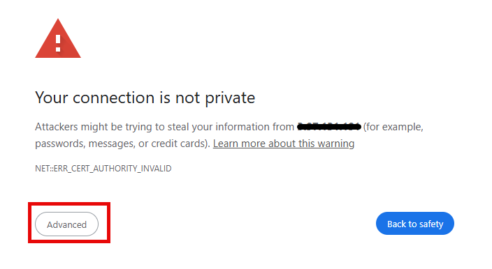
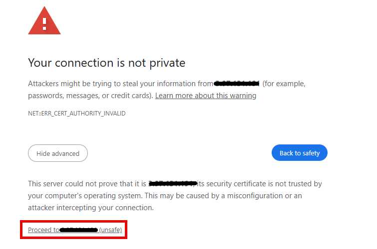
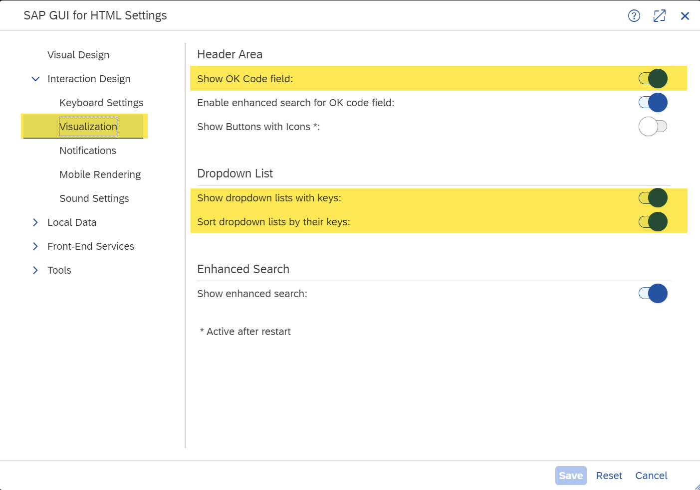
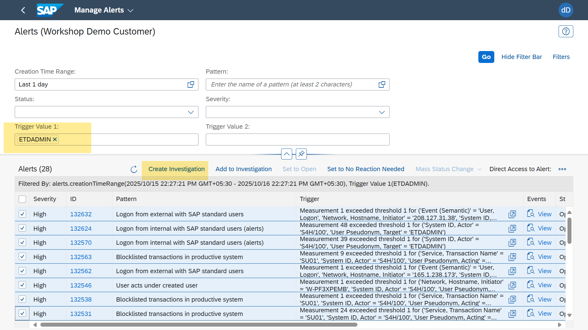
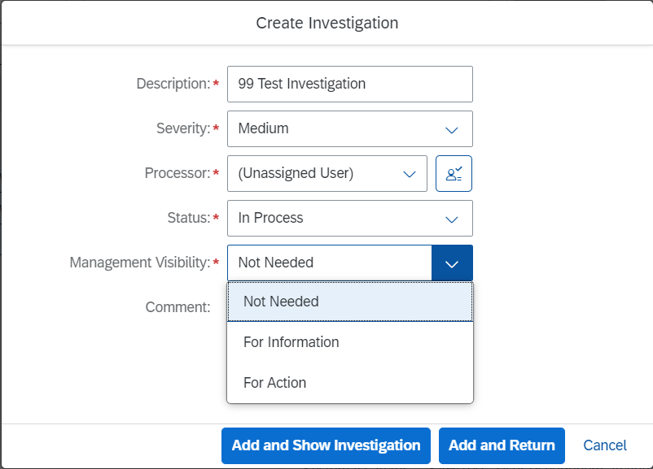
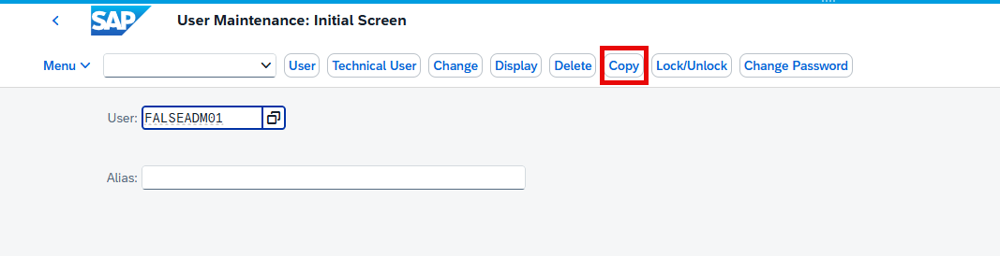
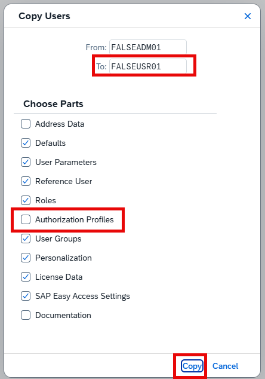
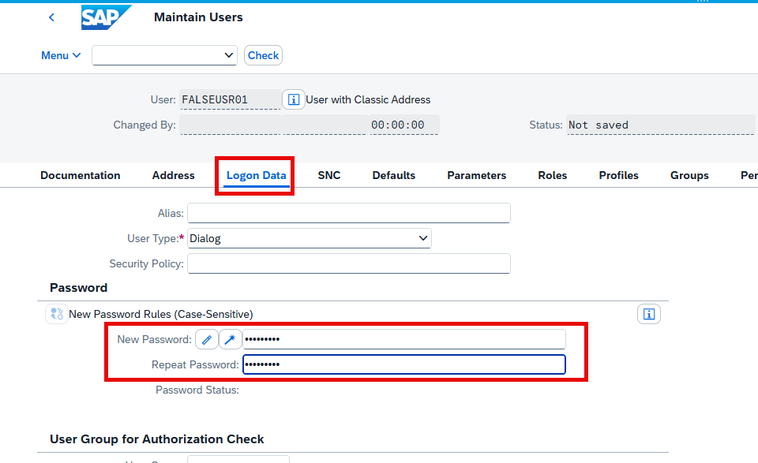
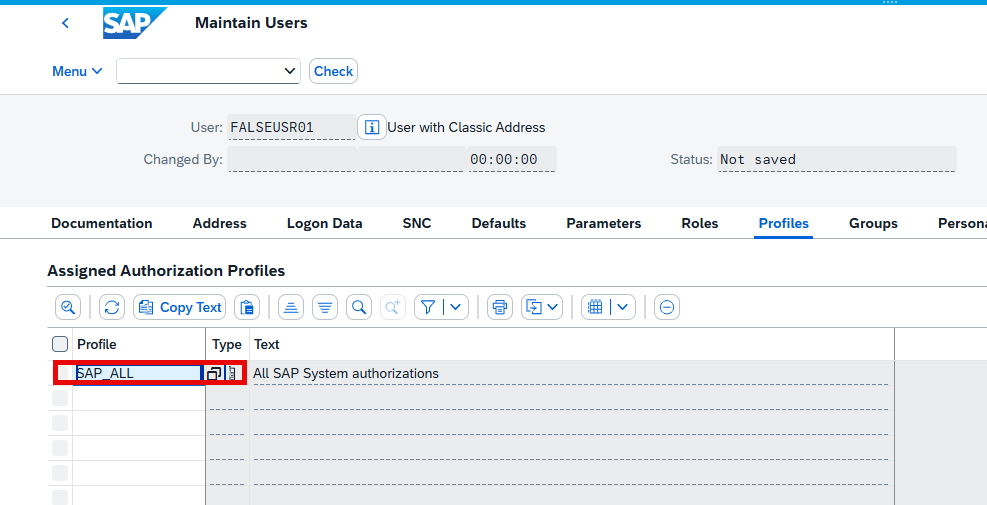
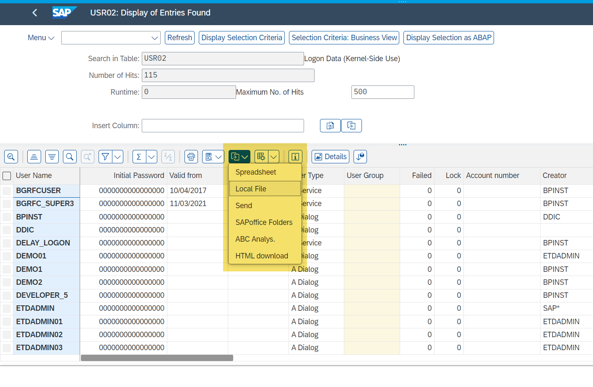

# First Log Events from SAP S/4HANA

Please note: in this exercise, every workshop station/computer has a
designated set of users already existing; throughout the description,
"##" is the number of your workshop computer ID.

In this section, you will conduct actions in SAP GUI to generate Log
Events which in return will result in Alerts in *SAP Enterprise Threat
Detection, public cloud*.

## Logon & Preparation Steps

- access the WebGUI interface:
  <https://3.97.131.191:44301/sap/bc/gui/sap/its/webgui>

- Proceed through the "advanced" mode in case you get a warning of
  unsafe/non-private connection -- which might look like this:

Log on credentials:

User: FALSEADM##

Password: Will be provided in the session

If you inadvertently lock the password, please notify the instructor.

If you should not see the 'OK Code' field:

- Activate the display of the "transaction code entry" field for easier
  navigation:
  Go to Menu 🡪 Settings 🡪 Visualization.
  Activate "Show OK Code field" as well as "Show dropdown lists with
  keys" and "Sort dropdown lists by their keys" and save.

> 

- Leave the menu. Your start screen should now show the transaction code
  entry field:

> 

## Creating a User With High Privileges

You will now conduct an action which triggers your first logs into *SAP
Enterprise Threat Detection, public cloud:* creating a highly privileged
user.

- In the transaction code entry, enter "SU01" (User Maintenance), and
  hit enter.

- In the User Maintenance transaction start screen, enter your user
  FALSEADM## in the User field, and select "copy".

- In the pop up screen, maintain the new user name "FALSEUSR##" in the
  "To:" field; deselect the option to copy authorization profiles, and
  press "copy":

- In the resulting screen set, on tab "Logon Data", assign an initial
  (temporary) password (it is suggested to note down this password as
  you will need this to log on with FALSEUSR##). Then save the user.

- Back in the SU01 initial screen, put in your user FALSEUSRxx and
  select the button "Change". Move to the tab "Profiles", add the
  profile "SAP_ALL" (making this user a super user basically without
  restrictions), and hit enter. Then press "Save".

- This has been the first set of noteworthy actions.

- Additionally, we suggest to call some other transactions with that
  user, which are presumably not alerted, but, however, logged, and can
  be seen later, in a Behavior analysis step for that user. **E.g.**
  (i.e. not restricted to) you can call transaction SU01D, SU24, BP, or
  FI02, which is not alerted, but may be to be considered in the context
  of the raised alerts.

- Exit the SAP Web GUI (button "Exit" in the top right; or hit Shift+F3;
  or in the transaction code entry field, type "/nex").

---
Prev: [1. Logon to the Monitoring Console](02_logon-to-monitoring-console.md) | Next: [3. Checking Alerts and Creating Investigations](04_checking-alerts-and-investigations.md) | [Contents](../README.MD)
