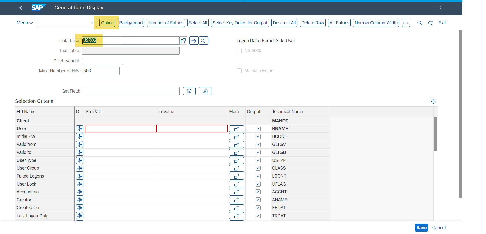

# Trigger a Critical Action from SAP S/4HANA: Download of a Critical Database Table

In this section, you will return into the role as a rogue actor and
conduct several more actions resulting in Log Events flowing into *SAP
Enterprise Threat Detection, public cloud*.

First, you need to log on to the SAP S/4HANA with the newly generated
user FALSEUSR##.

- In order to log on with your new user FALSEUSR##, you need to either
  **[open a new "incognito"/"private" session in your browser]{.mark}.**

Alternatively, you may also switch to another browser.
Emptying the browser cache is also an option. Here, mark at least
history, cookies, and password sections, then confirm).

- Now, call the Web Gui console
  <https://3.97.131.191:44301/sap/bc/gui/sap/its/webgui>, logon with
  your new user FALSEUSR## and the password you have chosen. At start,
  you need to set a new password (suggestion to take a note).

Executing a critical action:

- With the transaction code entry, navigate to transaction SE16N. This
  is a table display/download transaction (and a tool so powerful that
  it should generally not be made available in a productive system...).

- In the transaction, call table USR02. USR02 is a table which holds
  personal information (bad enough) and stores user password hashes
  (very critical: Although the passwords are hashed out, this would not
  stop a determined attacker. They may either crack simple passwords
  and, if they have identified out one single password from any user,
  they can take the respective hash value to overwrite the hashed
  password of any other user, allowing them to log on as that user i.e.
  impersonate the other user. Theoretically the password hashes should
  be "salted" however, in practice, this attack vector has been working
  quite reliably.

(That said, think about the value of MFA and other tools independent
from passwords).

- Access with the function "Online":

- Search for your user FALSEUSR## and display details. Check out
  Password Hash Value ( real table attribute name PWDSALTEDHASH),
  towards the end of the table.

- Return to the table display and trigger a download with the icon
  "Export", then choose "local file" and confirm the following two
  interactions. The file can be stored anywhere -- in case you need to
  indicate a directory, pick any that you like.

You have conducted a seemingly simple but dangerous activity which
should result in at least one Alert in *SAP Enterprise Threat Detection,
public cloud*.

Additionally, we suggest to call some other transactions with that user,
which are presumably not alerted, but, however, logged, and can be seen
later, in a Behavior analysis step for that user. **E.g.** you can call
transaction SU01D, SU24, BP, or FI02, which is not alerted, but may be
to be considered in the context of the raised alerts.

Let's continue to retrieve and process the raised alerts!

---
Prev: [3. Checking Alerts and Creating Investigations](04_checking-alerts-and-investigations.md) | Next: [5. User & Environment Behavioral Analysis](06_behavioral-analysis-forensic-lab.md) | [Contents](00_title-and-contents.md)
